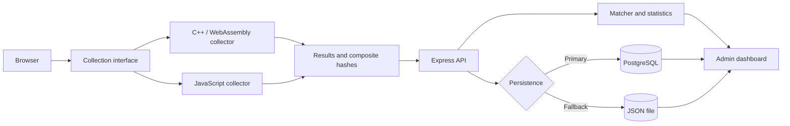

# WAFIR-FP: web fingerprinting in JavaScript and WebAssembly

**WAFIR-FP** is a research tool for collecting and comparing, within the same
browsing session, *web fingerprinting* attributes produced by two equivalent
implementations: JavaScript and C++ compiled to WebAssembly
(Wasm). Its goal is to study interoperability and reproducibility by identifying
when differences in APIs, types, numerical precision, serialization, or fallback
behavior affect the generated attributes and hashes.

The collectors cover **52 comparable fields**: 38 for the browser and DOM, 11 for
WebGL, 2 for audio, and 1 for Canvas. Each also produces SHA-256 hashes for each
component, a final hash, and availability and diagnostic metadata.

**Paper:** “WAFIR-FP: A Tool for Collecting and Comparatively Analyzing
Web Fingerprinting Attributes with WebAssembly”, prepared for the 26th Brazilian Symposium on
Information and Computer Systems Security — SBSeg 2026.

## Contents

- [Results reported in the paper](#results-reported-in-the-paper)
- [Architecture](#architecture)
- [Running with Docker](#running-with-docker)
- [Configuration](#configuration)
- [Local build and tests](#local-build-and-tests)
- [Collection format and comparison](#collection-format-and-comparison)
- [Reproducing experiments](#reproducing-experiments)
- [Research organization](#research-organization)
- [Privacy and limitations](#privacy-and-limitations)
- [Repository structure](#repository-structure)

## Results reported in the paper

The open experiment described in the paper collected sessions between **April 24 and
May 1, 2026**. Of the 1,054 collections, four were excluded because
more than half of their attributes were missing; the remaining 1,050 sessions yielded
54,600 attribute-by-attribute comparisons.

| Metric | Result |
| --- | ---: |
| Collections received | 1,054 |
| Valid sessions | 1,050 |
| Identical final hashes | 802 (76.38%) |
| Differing final hashes | 248 (23.62%) |
| Exactly matching attributes | 54,316 of 54,600 (99.48%) |
| Differing attributes | 284 of 54,600 (0.52%) |

A single difference among the 52 fields completely changes the final SHA-256 hash.
Therefore, the 76.38% hash match rate and the 99.48% attribute match rate
measure different phenomena. The categories found in the 248 sessions
with differences were:

| Category | Sessions | % of the 248 sessions with differences | % of the 1,050 valid sessions |
| --- | ---: | ---: | ---: |
| Missing `browser.vendor` | 136 | 54.84% | 12.95% |
| `devicePixelRatio` / `pixel_ratio` | 71 | 28.63% | 6.76% |
| Canvas | 26 | 10.48% | 2.48% |
| Window dimensions | 17 | 6.85% | 1.62% |
| Audio | 16 | 6.45% | 1.52% |
| WebGL | 1 | 0.40% | 0.10% |

The categories overlap: 230 sessions differed in one category, 17 in
two, and one in three. The main conclusion is that hashes alone cannot
distinguish an actual environmental difference from a difference in representation.
Normalization and diagnostics must precede identifier generation and
interpretation.

These figures describe the artifact and protocol used in the paper's
experiment; they are neither a performance benchmark nor a guaranteed rate for the
current source tree. The current collector contract (`collector_version: "1.2"`) already standardizes
missing values as `Unavailable` and records `available`,
`unavailable_fields`, and `collection_status`. Decimal normalization of
fractional values, investigation of the audio pipeline, and Canvas instrumentation
remain relevant. See the [full summary of the
results](docs/open-experiment-2026.md).

## Architecture



The interface runs the WebAssembly collection first, followed by the JavaScript collection. This order prevents the collectors from running concurrently during measurement. PostgreSQL is used when available; the JSON file serves as a fallback rather than an automatic mirror of the database.

The Wasm collector is hybrid: the C++ module coordinates processing, normalization,
hashing, and output assembly, but uses JavaScript bridges (`EM_JS`) to access
Web APIs, which are not directly accessible from WebAssembly. For audio
collection, for example, JavaScript renders the signal and transfers 5,000 samples to
linear memory; aggregation and numerical normalization run in
C++/Wasm.

The components, flow, and trust boundaries are described in [docs/architecture.md](docs/architecture.md).

## Running with Docker

### Prerequisites

- Git;
- Docker Engine with Docker Compose, or Docker Desktop;
- a modern browser with support for WebAssembly, Web Crypto, Canvas, WebGL, and
  Web Audio. Blocked or unavailable APIs are recorded in the diagnostics.

Docker installation by platform:

- [Windows](https://docs.docker.com/desktop/install/windows-install/)
- [macOS](https://docs.docker.com/desktop/install/mac-install/)
- [Linux](https://docs.docker.com/engine/install/)

### Pinned versions

| Component | Version |
| --- | --- |
| Node.js | 24.x |
| npm | 11.x |
| Emscripten | 5.0.2 |
| PostgreSQL | 16 Alpine |

For local compilation outside Docker, `npm run build` uses the `em++` available in the environment. The recommended version remains Emscripten 5.0.2.

### Startup

```sh
git clone https://github.com/WAFIR-FP/sbseg-wafir-fp.git
cd sbseg-wafir-fp
cp .env.example .env
```

Before starting, edit `.env` and replace at least `ADMIN_USERNAME`, `ADMIN_PASSWORD`, and `POSTGRES_PASSWORD`. Do not commit the `.env` file to version control.

```sh
docker compose up --build
```

The first build downloads the images, compiles the C++ code to WebAssembly, and installs the server dependencies. When the terminal indicates that the server is running, open [http://localhost:3000](http://localhost:3000). The admin dashboard is available at [http://localhost:3000/admin/login](http://localhost:3000/admin/login), and the server status can be checked at [http://localhost:3000/health](http://localhost:3000/health).

Port `3000` serves the HTTP application. Port `5432`, exposed by Compose, accepts the PostgreSQL protocol and does not display a page in the browser; use a PostgreSQL client to access it.

In production, `ADMIN_USERNAME` and `ADMIN_PASSWORD` are required, and the default admin password is rejected. Also set `PUBLIC_BASE_URL` to the application's public origin so that the QR code points to the correct address.

To stop the containers without deleting the database:

```sh
docker compose down
```

## Configuration

The [.env.example](.env.example) file documents all variables recognized by the application and Docker Compose. The main ones are:

| Variable | Purpose |
| --- | --- |
| `PORT`, `HOST` | HTTP server port and network interface |
| `PUBLIC_BASE_URL` | Public origin used in links and the QR code |
| `ADMIN_USERNAME`, `ADMIN_PASSWORD` | Admin dashboard credentials |
| `POSTGRES_USER`, `POSTGRES_PASSWORD`, `POSTGRES_DB` | Database creation in Docker Compose |
| `DB_ENABLED`, `DB_HOST`, `DB_PORT`, `DB_NAME`, `DB_USER`, `DB_PASSWORD` | Application connection to PostgreSQL |
| `DATABASE_URL` | Alternative to the `DB_*` variables for providers that supply a single URL |
| `DATA_DIR`, `LOG_FILE` | File persistence used as a fallback |
| `ENABLE_RATE_LIMIT`, `RATE_LIMIT_*` | General request rate limiting |
| `ADMIN_LOGIN_*` | Rate limiting for admin login attempts |

In Docker Compose, the database hostname is `wasm-db`. Outside Docker, it will usually be `localhost` or the address of the PostgreSQL service in use. Node.js does not load `.env` automatically when running `npm start`; Docker Compose reads that file. To run locally with a separate file, copy the example to `.env.local`, set `DB_HOST=localhost` and `DATA_DIR=./data`, and either configure a local PostgreSQL instance or set `DB_ENABLED=false`. Then use Node.js 24's environment file support:

```sh
node --env-file=.env.local app.js
```

## Local build and tests

To work outside Docker, install Node.js 24, npm 11, a C++ compiler, and Emscripten 5.0.2. Then run:

```sh
npm ci
npm run build
make test
npm start
```

`npm run build` uses the `em++` installed in the environment and generates `build/lib_fp.js` and `build/lib_fp.wasm`. The `make test` command runs the C++ tests first, followed by the Node.js tests, reporting each verified behavior and the final summary in Portuguese.

The `build/`, `data/`, and `node_modules/` directories are local artifacts and should not be committed to version control.

## Collection format and comparison

The JavaScript and C++/WebAssembly collectors return the Canvas, WebGL, audio, and browser components, along with `collector`, `collector_version`, and `collection_status`. Each component reports `available`; browser fields that could not be obtained appear in `unavailable_fields`.

| Category | Compared fields | Summary |
| --- | ---: | --- |
| Browser and DOM | 38 | `Navigator`, `Screen`, `Window`, storage, and API support |
| WebGL | 11 | Context, GPU, limits, shaders, and framebuffer sample |
| Audio | 2 | Effective sample rate and value calculated from 5,000 samples |
| Canvas | 1 | PNG serialized by `toDataURL()` |
| **Total** | **52** | Metadata and hashes are not included in this count |

A failure in one JavaScript collector does not interrupt the others. Fallbacks are standardized, and the matcher excludes unavailable components or attributes from the score. The comparison API response includes `diagnostics.excludedComponents` to explain reductions in coverage.

Hashes are not calculated by arbitrarily serializing the final JSON. Each collector explicitly assembles the inputs for the component hashes and the composite hash in a fixed order. Diagnostic fields are not included in these hashes. The structure, fallbacks, error codes, weights, and thresholds are documented in [docs/collection-format.md](docs/collection-format.md).

## Reproducing experiments

The procedure below reproduces the **collection flow**. Reproducing the percentages
in the paper also requires the same artifact version, population, period, exclusion
criteria, and analysis method:

1. Record the commit, browser, operating system, and hardware used.
2. Start the environment with `docker compose up --build`.
3. Open `http://localhost:3000` and start the collection.
4. Wait for the WebAssembly and JavaScript collectors to run sequentially.
5. Check the displayed hashes, component data, and exploratory timings.
6. View the statistics and JSON data in the Dashboard.

With `DATABASE_URL` or `DB_ENABLED=true`, records are written to PostgreSQL. If the database is not configured or the operation fails, the application uses the JSON file in `DATA_DIR`; admin reads merge database and fallback records by collection ID.

## Research organization

The repository separates three responsibilities:

| Layer | Content |
| --- | --- |
| `src/` | Application and collector implementation |
| `docs/` | Architecture, collection format, data governance, and results summary |
| `tests/` | Tests for C++ processing and the Node.js application |

This separation keeps implementation, research documentation, and
automated checks in distinct areas. The documentation index is available in
[docs/README.md](docs/README.md).

## Privacy and limitations

A fingerprint characterizes the observed environment and does not establish a person's identity. Changes to the browser, system, driver, hardware, or privacy settings can affect the result; different environments can also produce similar signals.

The [docs/privacy-ethics-limitations.md](docs/privacy-ethics-limitations.md) document details the observed data, linkability risks, safeguards, and scientific limitations.

## Repository structure

```text
sbseg-wafir-fp/
├── docs/                       # Architecture, privacy, and scientific documentation
├── src/                        # Main source code
│   ├── assets/                 # Images, favicon, and manifest
│   ├── config/                 # Application configuration
│   ├── controllers/            # HTTP controllers
│   ├── fingerprint/
│   │   ├── cpp/                # C++ collector compiled to WebAssembly
│   │   └── js/                 # Reference JavaScript collector
│   ├── fingerprint-matcher/    # Comparison and grouping
│   ├── middleware/             # Authentication and security
│   ├── routes/                 # HTTP routes
│   ├── services/               # Persistence, sessions, and business rules
│   └── views/                  # Templates and rendering
├── app.js                      # Server entry point
├── .env.example                # Example local and Compose configuration
├── .gitignore                  # Credential and local artifact exclusions
├── Dockerfile                  # WebAssembly build and Node.js image
├── docker-compose.yml          # Application and PostgreSQL
├── Makefile                    # Local WebAssembly module build
├── package.json                # Node.js dependencies and commands
├── tests/                      # C++ and Node.js tests
└── LICENSE                     # MIT License
```

The `data/` and `build/` directories are generated at runtime and are not part of the research layers tracked in version control.

## License

This project is licensed under the [MIT License](LICENSE).
