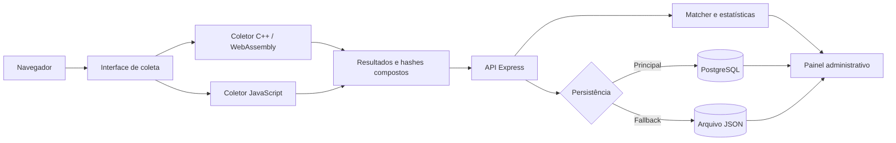

# WAFIR-FP: web fingerprinting em JavaScript e WebAssembly

O **WAFIR-FP** é uma ferramenta de pesquisa para coletar e comparar, na mesma
sessão de navegação, atributos de *web fingerprinting* produzidos por duas
implementações equivalentes: JavaScript e C++ compilado para WebAssembly
(Wasm). O objetivo é estudar interoperabilidade e reprodutibilidade, identificando
quando diferenças de API, tipos, precisão numérica, serialização ou fallback
alteram os atributos e os hashes gerados.

Os coletores cobrem **52 campos comparáveis**: 38 de navegador e DOM, 11 de
WebGL, 2 de áudio e 1 de Canvas. Cada um também produz hashes SHA-256 por
componente, um hash final e metadados de disponibilidade e diagnóstico.

**Artigo:** “WAFIR-FP: Uma Ferramenta para Coleta e Análise Comparativa de
Atributos de Web Fingerprinting com WebAssembly”, preparado para o XXVI Simpósio Brasileiro de
Segurança da Informação e de Sistemas Computacionais — SBSeg 2026.

## Conteúdo

- [Resultados reportados no artigo](#resultados-reportados-no-artigo)
- [Arquitetura](#arquitetura)
- [Execução com Docker](#execução-com-docker)
- [Configuração](#configuração)
- [Build local e testes](#build-local-e-testes)
- [Formato da coleta e comparação](#formato-da-coleta-e-comparação)
- [Reprodução de experimentos](#reprodução-de-experimentos)
- [Organização de pesquisa](#organização-de-pesquisa)
- [Privacidade e limitações](#privacidade-e-limitações)
- [Estrutura do repositório](#estrutura-do-repositório)

## Resultados reportados no artigo

O experimento aberto descrito no artigo reuniu sessões entre **24 de abril e
1º de maio de 2026**. Das 1.054 coletas, quatro foram excluídas por conterem
mais da metade dos atributos ausentes; as 1.050 sessões restantes originaram
54.600 comparações atributo a atributo.

| Métrica | Resultado |
| --- | ---: |
| Coletas recebidas | 1.054 |
| Sessões válidas | 1.050 |
| Hashes finais idênticos | 802 (76,38%) |
| Hashes finais divergentes | 248 (23,62%) |
| Atributos exatamente iguais | 54.316 de 54.600 (99,48%) |
| Atributos divergentes | 284 de 54.600 (0,52%) |

Uma única diferença entre os 52 campos modifica completamente o SHA-256 final.
Por isso, a igualdade de 76,38% dos hashes e a igualdade de 99,48% dos atributos
medem fenômenos diferentes. As categorias encontradas nas 248 sessões
divergentes foram:

| Categoria | Sessões | % das 248 divergentes | % das 1.050 válidas |
| --- | ---: | ---: | ---: |
| `browser.vendor` ausente | 136 | 54,84% | 12,95% |
| `devicePixelRatio` / `pixel_ratio` | 71 | 28,63% | 6,76% |
| Canvas | 26 | 10,48% | 2,48% |
| Dimensões da janela | 17 | 6,85% | 1,62% |
| Áudio | 16 | 6,45% | 1,52% |
| WebGL | 1 | 0,40% | 0,10% |

As categorias se sobrepõem: 230 sessões divergiram em uma categoria, 17 em
duas e uma em três. A principal conclusão é que os hashes, isoladamente, não
distinguem uma diferença efetiva do ambiente de uma diferença de representação.
Normalização e diagnóstico precisam ocorrer antes da geração e da interpretação
dos identificadores.

Esses números descrevem o artefato e o protocolo usados no experimento do
artigo; não constituem benchmark de desempenho nem taxa garantida para a árvore
atual. O contrato atual dos coletores (`collector_version: "1.2"`) já uniformiza
valores ausentes como `Unavailable` e registra `available`,
`unavailable_fields` e `collection_status`. A normalização decimal de valores
fracionários, a investigação do pipeline de áudio e a instrumentação de Canvas
continuam relevantes. Consulte a [síntese completa dos
resultados](docs/open-experiment-2026.md).

## Arquitetura



A interface executa primeiro a coleta WebAssembly e depois a coleta JavaScript. Essa ordem evita concorrência entre os coletores durante a medição. PostgreSQL é usado quando está disponível; o arquivo JSON funciona como fallback, e não como espelho automático do banco.

O coletor Wasm é híbrido: o módulo C++ coordena processamento, normalização,
hashes e montagem da saída, mas usa pontes JavaScript (`EM_JS`) para acessar as
APIs Web, que não são diretamente acessíveis pelo WebAssembly. Na coleta de
áudio, por exemplo, JavaScript renderiza o sinal e transfere 5.000 amostras para
a memória linear; a agregação e a normalização numérica são executadas em
C++/Wasm.

A descrição dos componentes, do fluxo e das fronteiras de confiança está em [docs/architecture.md](docs/architecture.md).

## Execução com Docker

### Pré-requisitos

- Git;
- Docker Engine com Docker Compose, ou Docker Desktop;
- um navegador moderno com suporte a WebAssembly, Web Crypto, Canvas, WebGL e
  Web Audio. APIs bloqueadas ou indisponíveis são registradas nos diagnósticos.

Instalação do Docker por plataforma:

- [Windows](https://docs.docker.com/desktop/install/windows-install/)
- [macOS](https://docs.docker.com/desktop/install/mac-install/)
- [Linux](https://docs.docker.com/engine/install/)

### Versões fixadas

| Componente | Versão |
| --- | --- |
| Node.js | 24.x |
| npm | 11.x |
| Emscripten | 5.0.2 |
| PostgreSQL | 16 Alpine |

Para compilação local fora do Docker, o comando `npm run build` usa o `em++` disponível no ambiente. A versão recomendada permanece Emscripten 5.0.2.

### Inicialização

```sh
git clone https://github.com/WAFIR-FP/sbseg-wafir-fp.git
cd sbseg-wafir-fp
cp .env.example .env
```

Antes de iniciar, edite `.env` e substitua pelo menos `ADMIN_USERNAME`, `ADMIN_PASSWORD` e `POSTGRES_PASSWORD`. Não versione o arquivo `.env`.

```sh
docker compose up --build
```

O primeiro build baixa as imagens, compila o código C++ para WebAssembly e instala as dependências do servidor. Quando o terminal indicar que o servidor está em execução, acesse [http://localhost:3000](http://localhost:3000). O painel administrativo fica em [http://localhost:3000/admin/login](http://localhost:3000/admin/login), e o estado do servidor pode ser consultado em [http://localhost:3000/health](http://localhost:3000/health).

A porta `3000` serve a aplicação HTTP. A porta `5432`, exposta pelo Compose, aceita o protocolo PostgreSQL e não apresenta uma página no navegador; use um cliente PostgreSQL para acessá-la.

Em produção, `ADMIN_USERNAME` e `ADMIN_PASSWORD` são obrigatórios e a senha administrativa padrão é recusada. Defina também `PUBLIC_BASE_URL` com a origem pública da aplicação para que o QR Code aponte para o endereço correto.

Para encerrar os contêineres sem apagar o banco:

```sh
docker compose down
```

## Configuração

O arquivo [.env.example](.env.example) documenta todas as variáveis reconhecidas pela aplicação e pelo Docker Compose. As principais são:

| Variável | Finalidade |
| --- | --- |
| `PORT`, `HOST` | Porta e interface do servidor HTTP |
| `PUBLIC_BASE_URL` | Origem pública usada nos links e no QR Code |
| `ADMIN_USERNAME`, `ADMIN_PASSWORD` | Credenciais do painel administrativo |
| `POSTGRES_USER`, `POSTGRES_PASSWORD`, `POSTGRES_DB` | Criação do banco no Docker Compose |
| `DB_ENABLED`, `DB_HOST`, `DB_PORT`, `DB_NAME`, `DB_USER`, `DB_PASSWORD` | Conexão da aplicação com PostgreSQL |
| `DATABASE_URL` | Alternativa às variáveis `DB_*` para provedores que entregam uma URL única |
| `DATA_DIR`, `LOG_FILE` | Persistência em arquivo usada como fallback |
| `ENABLE_RATE_LIMIT`, `RATE_LIMIT_*` | Limitação geral de requisições |
| `ADMIN_LOGIN_*` | Limitação das tentativas de login administrativo |

No Docker Compose, o hostname do banco é `wasm-db`. Fora do Docker, normalmente será `localhost` ou o endereço do serviço PostgreSQL utilizado. O Node.js não carrega `.env` automaticamente ao executar `npm start`; esse arquivo é consumido pelo Docker Compose. Para execução local com um arquivo separado, copie o exemplo para `.env.local`, ajuste `DB_HOST=localhost` e `DATA_DIR=./data` e escolha entre configurar um PostgreSQL local ou definir `DB_ENABLED=false`. Depois, use o suporte do Node.js 24:

```sh
node --env-file=.env.local app.js
```

## Build local e testes

Para trabalhar fora do Docker, instale Node.js 24, npm 11, um compilador C++ e Emscripten 5.0.2. Em seguida:

```sh
npm ci
npm run build
make test
npm start
```

`npm run build` usa o `em++` instalado no ambiente e gera `build/lib_fp.js` e `build/lib_fp.wasm`. O comando `make test` executa primeiro os testes C++ e depois os testes Node.js, apresentando em português cada comportamento verificado e o resumo final.

Os diretórios `build/`, `data/` e `node_modules/` são artefatos locais e não devem ser versionados.

## Formato da coleta e comparação

Os coletores JavaScript e C++/WebAssembly retornam os componentes Canvas, WebGL, áudio e navegador, além de `collector`, `collector_version` e `collection_status`. Cada componente informa `available`; campos de navegador que não puderam ser obtidos aparecem em `unavailable_fields`.

| Categoria | Campos comparados | Resumo |
| --- | ---: | --- |
| Navegador e DOM | 38 | `Navigator`, `Screen`, `Window`, armazenamento e suporte a APIs |
| WebGL | 11 | contexto, GPU, limites, shaders e amostra do framebuffer |
| Áudio | 2 | taxa efetiva e valor calculado sobre 5.000 amostras |
| Canvas | 1 | PNG serializado por `toDataURL()` |
| **Total** | **52** | Metadados e hashes não entram nessa contagem |

Uma falha em um coletor JavaScript não interrompe os demais. Os fallbacks são padronizados e o matcher exclui componentes ou atributos indisponíveis da pontuação. A resposta da API de comparação inclui `diagnostics.excludedComponents` para explicar perdas de cobertura.

Os hashes não são calculados serializando arbitrariamente o JSON final. Cada coletor monta explicitamente, em ordem fixa, as entradas dos hashes de componente e do hash composto. Campos de diagnóstico não participam desses hashes. Estrutura, fallbacks, códigos de erro, pesos e limiares estão documentados em [docs/collection-format.md](docs/collection-format.md).

## Reprodução de experimentos

O procedimento abaixo reproduz o **fluxo de coleta**. Reproduzir os percentuais
do artigo exige também a mesma versão do artefato, população, período, critérios
de exclusão e método de análise:

1. Registre o commit, o navegador, o sistema operacional e o hardware usados.
2. Inicie o ambiente com `docker compose up --build`.
3. Acesse `http://localhost:3000` e inicie a coleta.
4. Aguarde a execução sequencial dos coletores WebAssembly e JavaScript.
5. Verifique os hashes, os dados dos componentes e os tempos exploratórios apresentados.
6. Consulte as estatísticas e os dados JSON no Dashboard.

Com `DATABASE_URL` ou `DB_ENABLED=true`, os registros são gravados no PostgreSQL. Se o banco não estiver configurado ou a operação falhar, a aplicação usa o arquivo JSON em `DATA_DIR`; leituras administrativas unem registros do banco e do fallback pelo ID da coleta.

## Organização de pesquisa

O repositório separa três responsabilidades:

| Camada | Conteúdo |
| --- | --- |
| `src/` | Implementação da aplicação e dos coletores |
| `docs/` | Arquitetura, formato da coleta, governança dos dados e síntese dos resultados |
| `tests/` | Testes do processamento C++ e da aplicação Node.js |

Essa separação mantém a implementação, a documentação de pesquisa e as
verificações automatizadas em áreas distintas. O índice da documentação está em
[docs/README.md](docs/README.md).

## Privacidade e limitações

Um fingerprint caracteriza o ambiente observado e não comprova a identidade de uma pessoa. Mudanças de navegador, sistema, driver, hardware ou configurações de privacidade podem alterar o resultado; ambientes diferentes também podem produzir sinais semelhantes.

O documento [docs/privacy-ethics-limitations.md](docs/privacy-ethics-limitations.md) detalha os dados observados, riscos de vinculação, salvaguardas e limitações científicas.

## Estrutura do repositório

```text
sbseg-wafir-fp/
├── docs/                       # Arquitetura, privacidade e documentação científica
├── src/                        # Código-fonte principal
│   ├── assets/                 # Imagens, favicon e manifesto
│   ├── config/                 # Configuração da aplicação
│   ├── controllers/            # Controladores HTTP
│   ├── fingerprint/
│   │   ├── cpp/                # Coletor C++ compilado para WebAssembly
│   │   └── js/                 # Coletor JavaScript de referência
│   ├── fingerprint-matcher/    # Comparação e agrupamento
│   ├── middleware/             # Autenticação e segurança
│   ├── routes/                 # Rotas HTTP
│   ├── services/               # Persistência, sessões e regras de negócio
│   └── views/                  # Templates e renderização
├── app.js                      # Entrada do servidor
├── .env.example                # Exemplo de configuração local e do Compose
├── .gitignore                  # Exclusões de credenciais e artefatos locais
├── Dockerfile                  # Build WebAssembly e imagem Node.js
├── docker-compose.yml          # Aplicação e PostgreSQL
├── Makefile                    # Build local do módulo WebAssembly
├── package.json                # Dependências e comandos Node.js
├── tests/                      # Testes C++ e Node.js
└── LICENSE                     # Licença MIT
```

O diretório `data/` e o diretório `build/` são gerados durante a execução e não fazem parte das camadas de pesquisa versionadas.

## Licença

Este projeto está licenciado sob a [Licença MIT](LICENSE).
