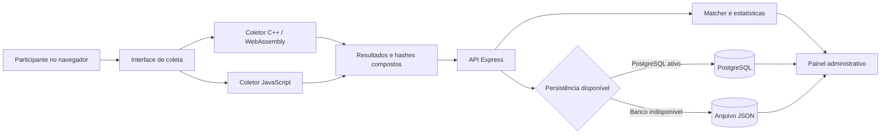

# Arquitetura

## Visão geral

## Componentes

| Componente | Responsabilidade | Localização |
| --- | --- | --- |
| Interface de coleta | Inicializa os módulos, apresenta os resultados e envia a coleta | `src/views/templates/coleta-fingerprint.html` |
| Coletor WebAssembly | Obtém sinais de Canvas, WebGL, áudio e navegador por C++ compilado com Emscripten | `src/fingerprint/cpp/` |
| Coletor JavaScript | Produz uma implementação de referência para a comparação experimental | `src/fingerprint/js/` |
| API | Valida requisições e coordena os serviços | `src/controllers/` e `src/routes/` |
| Matcher | Calcula similaridade e agrupa fingerprints segundo os limiares configurados | `src/fingerprint-matcher/` |
| Persistência | Usa PostgreSQL quando disponível e arquivo JSON como fallback | `src/services/log.service.js` |
| Administração | Consulta registros, estatísticas e comparações | `src/controllers/admin.controller.js` e `src/views/templates/admin.html` |

## Fluxo de coleta

1. A página carrega uma única instância do runtime C++/WebAssembly.
2. A coleta WebAssembly é executada e cronometrada.
3. A coleta JavaScript é executada em seguida, sem concorrência com a primeira.
4. Cada implementação produz hashes dos componentes, um hash composto e diagnósticos de disponibilidade.
5. A interface apresenta os dados e envia o resultado à API.
6. A API sanitiza o payload, calcula o identificador e persiste o registro.

A execução sequencial evita concorrência direta entre os coletores, mas também
introduz um intervalo entre as observações. Propriedades dinâmicas, como
dimensões da janela, orientação e barras do navegador, podem mudar nesse
intervalo. Os tempos mostrados pela interface são observações exploratórias de
uma execução; o artigo não os avaliou como benchmark de desempenho.

O coletor WebAssembly usa bindings JavaScript para acessar APIs exclusivas do
navegador, pois Wasm não possui acesso direto a Canvas, WebGL, Web Audio,
`Navigator`, `Screen` ou `Window`. Na coleta de áudio, o binding renderiza o
sinal com `OfflineAudioContext` e copia 5.000 amostras para a memória linear; a
agregação, a conversão para `Float32`, a normalização e a entrada do hash são
processadas em C++/Wasm. Canvas e WebGL também são renderizados nas pontes
`EM_JS`. Assim, a implementação deve ser entendida como híbrida
C++/Wasm–JavaScript, e a fronteira de interoperabilidade faz parte do objeto de
estudo.

No coletor JavaScript, Canvas, WebGL, navegador e áudio são isolados com `Promise.allSettled`. Portanto, a indisponibilidade de uma API não elimina os resultados dos demais componentes. O coletor C++/WebAssembly aplica fallbacks equivalentes nas pontes `EM_JS` e informa erros de contexto, renderização ou validação no objeto `collection_status`.

## Integridade dos hashes e diagnóstico

O hash final não é calculado sobre a serialização do JSON completo. Cada implementação constrói explicitamente as entradas dos hashes em uma ordem fixa, evitando dependência da ordem de propriedades dos objetos recebidos. Metadados como `available`, `unavailable_fields` e `collection_status` permanecem fora do material do hash.

O matcher ignora componentes marcados com `available: false` e atributos listados em `unavailable_fields`. A pontuação é normalizada pelo peso disponível e a decisão oficial exige cobertura mínima. A API de comparação devolve a cobertura e os componentes excluídos para que uma igualdade de fallback não seja interpretada como evidência de mesma máquina.

O contrato completo está em [collection-format.md](collection-format.md).

## Persistência

PostgreSQL é o destino primário quando `DB_ENABLED=true` ou `DATABASE_URL` está definida. Se o banco não estiver configurado ou a gravação falhar, o serviço usa o arquivo JSON configurado em `DATA_DIR`. Os destinos não são espelhos automáticos, mas as leituras administrativas unem os registros pelo ID de cada coleta para não ocultar dados gravados durante uma indisponibilidade temporária do banco.

## Fronteiras de confiança

- O navegador é uma fonte de dados não confiável; o servidor valida o formato do payload.
- O painel administrativo usa uma sessão `HttpOnly`, `Secure` em produção e `SameSite=Strict`; credenciais explícitas são obrigatórias em produção.
- Fingerprints e hashes persistentes podem permitir correlação entre sessões e devem ser tratados como dados potencialmente identificáveis.
