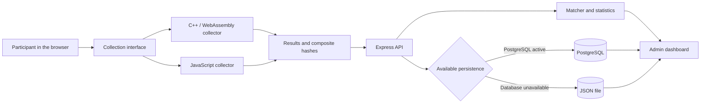

# Architecture

## Overview

## Components

| Component | Responsibility | Location |
| --- | --- | --- |
| Collection interface | Initializes the modules, displays the results, and submits the collection | `src/views/templates/coleta-fingerprint.html` |
| WebAssembly collector | Obtains Canvas, WebGL, audio, and browser signals through C++ compiled with Emscripten | `src/fingerprint/cpp/` |
| JavaScript collector | Provides a reference implementation for experimental comparison | `src/fingerprint/js/` |
| API | Validates requests and coordinates services | `src/controllers/` and `src/routes/` |
| Matcher | Calculates similarity and groups fingerprints according to the configured thresholds | `src/fingerprint-matcher/` |
| Persistence | Uses PostgreSQL when available and a JSON file as a fallback | `src/services/log.service.js` |
| Administration | Queries records, statistics, and comparisons | `src/controllers/admin.controller.js` and `src/views/templates/admin.html` |

## Collection flow

1. The page loads a single instance of the C++/WebAssembly runtime.
2. The WebAssembly collection runs and is timed.
3. The JavaScript collection runs next, without running concurrently with the first.
4. Each implementation produces component hashes, a composite hash, and availability diagnostics.
5. The interface displays the data and sends the result to the API.
6. The API sanitizes the payload, calculates the identifier, and persists the record.

Sequential execution prevents direct concurrency between the collectors, but also
introduces an interval between observations. Dynamic properties, such as
window dimensions, orientation, and browser bars, can change during this
interval. The timings displayed by the interface are exploratory observations from
a single run; the paper did not evaluate them as a performance benchmark.

The WebAssembly collector uses JavaScript bindings to access browser-only
APIs, since Wasm has no direct access to Canvas, WebGL, Web Audio,
`Navigator`, `Screen`, or `Window`. For audio collection, the binding renders the
signal with `OfflineAudioContext` and copies 5,000 samples to linear memory;
aggregation, conversion to `Float32`, normalization, and hash input preparation are
handled in C++/Wasm. Canvas and WebGL rendering also occurs in the
`EM_JS` bridges. Thus, the implementation should be understood as a hybrid
C++/Wasm–JavaScript implementation, and the interoperability boundary is part of the subject
under study.

In the JavaScript collector, Canvas, WebGL, browser, and audio collection are isolated using `Promise.allSettled`. Therefore, an unavailable API does not eliminate the results of the other components. The C++/WebAssembly collector applies equivalent fallbacks in the `EM_JS` bridges and reports context, rendering, or validation errors in the `collection_status` object.

## Hash integrity and diagnostics

The final hash is not calculated from the serialization of the complete JSON. Each implementation explicitly constructs the hash inputs in a fixed order, avoiding dependence on the property order of the received objects. Metadata such as `available`, `unavailable_fields`, and `collection_status` remain outside the hash input.

The matcher ignores components marked with `available: false` and attributes listed in `unavailable_fields`. The score is normalized by the available weight, and the final decision requires minimum coverage. The comparison API returns coverage and excluded components so that matching fallback values are not interpreted as evidence of the same machine.

The full contract is available in [collection-format.md](collection-format.md).

## Persistence

PostgreSQL is the primary destination when `DB_ENABLED=true` or `DATABASE_URL` is set. If the database is not configured or the write fails, the service uses the JSON file configured in `DATA_DIR`. The destinations are not automatic mirrors, but admin reads merge records by collection ID to avoid hiding data written during temporary database unavailability.

## Trust boundaries

- The browser is an untrusted data source; the server validates the payload format.
- The admin dashboard uses an `HttpOnly` session with `Secure` in production and `SameSite=Strict`; explicit credentials are required in production.
- Persistent fingerprints and hashes may allow correlation across sessions and should be treated as potentially identifiable data.
